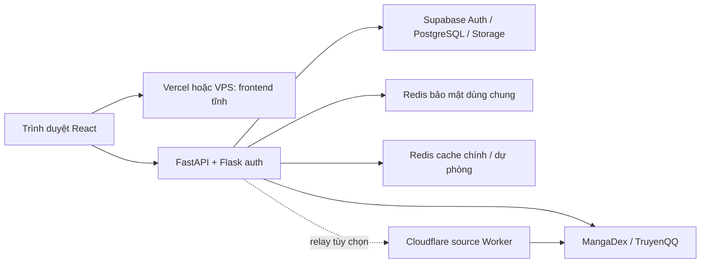

# MangaHub

Ứng dụng đọc và quản lý truyện tranh, gồm giao diện React, API FastAPI, cổng xác thực Flask và dữ liệu người dùng trên Supabase. Hai nguồn truyện đang được tích hợp là **TruyenQQ** và **MangaDex**; ứng dụng cũng hỗ trợ truyện/chương do thành viên có quyền tải lên.

Repository: [deno4908/MANGAHUB](https://github.com/deno4908/MANGAHUB). Website triển khai: [mangahub.art](https://mangahub.art).

## Mục lục

- [Chức năng](#chức-năng)
- [Công nghệ và kiến trúc](#công-nghệ-và-kiến-trúc)
- [Cấu trúc thư mục](#cấu-trúc-thư-mục)
- [Yêu cầu trước khi chạy](#yêu-cầu-trước-khi-chạy)
- [Tạo database Supabase](#tạo-database-supabase)
- [Chạy trên máy cá nhân](#chạy-trên-máy-cá-nhân)
- [Biến môi trường](#biến-môi-trường)
- [Thiết lập đăng nhập, email và quyền quản trị](#thiết-lập-đăng-nhập-email-và-quyền-quản-trị)
- [Build và kiểm tra](#build-và-kiểm-tra)
- [Triển khai Vercel](#triển-khai-vercel)
- [Triển khai VPS và máy dự phòng](#triển-khai-vps-và-máy-dự-phòng)
- [Cloudflare, Redis và hiệu năng](#cloudflare-redis-và-hiệu-năng)
- [Xử lý sự cố](#xử-lý-sự-cố)
- [Quy tắc đưa file lên Git](#quy-tắc-đưa-file-lên-git)

## Chức năng

| Nhóm | Các chức năng có trong mã nguồn |
| --- | --- |
| Khám phá truyện | Trang chủ, banner, mới cập nhật, phổ biến, đánh giá cao; chọn nguồn, tìm kiếm và gợi ý nhanh theo tên truyện/tác giả. |
| Danh sách và bộ lọc | Thể loại, từ khóa, trạng thái, sắp xếp cập nhật/phổ biến/A–Z và phân trang. Các bộ lọc được áp dụng theo khả năng từng nguồn. |
| MangaDex | Danh mục, chi tiết, bìa, chương tiếng Việt, chỉ mục cập nhật theo chương, chương mới nhất bổ sung cho thẻ và gợi ý tìm kiếm. |
| TruyenQQ | Thu thập danh sách, chi tiết và chương bằng scraper tích hợp; relay nguồn tùy chọn; giữ dữ liệu đã lấy thành công khi nguồn tạm lỗi. |
| Trang truyện | Mô tả, tác giả, thể loại, danh sách chương, tìm chương, đánh giá, bình luận, theo dõi và lưu truyện. |
| Trình đọc | Đọc dọc/ngang/webtoon, hướng lật trang, kích thước ảnh, ẩn thanh công cụ, số trang, thanh tiến trình và chuyển chương. |
| Tải ảnh | Lazy loading, tải trước có giới hạn, cache ảnh, thử lại có giới hạn, phát hiện ảnh đứng tải và chuyển origin ảnh khi đủ điều kiện. |
| Thư viện cá nhân | Đang theo dõi, đã lưu, lịch sử, đọc tiếp đúng chương/vị trí; đồng bộ tiến trình nền, hoạt động đọc và chuỗi ngày đọc. |
| Tài khoản | Email/mật khẩu, xác minh email/OTP, Google, Discord, khôi phục/đổi mật khẩu, refresh phiên và đăng xuất. |
| Hồ sơ và cài đặt | Hồ sơ cá nhân/công khai, avatar, quyền riêng tư, tùy chọn trình đọc, thông báo và nội dung trưởng thành. |
| Cộng đồng | Bình luận, phản hồi, thích, biểu cảm, ảnh bình luận, chấm điểm, báo cáo nội dung và thông báo. |
| Upload | Dashboard, gửi truyện/chương, trang ảnh, bản nháp, gửi duyệt, xuất bản/từ chối và nhóm dịch với vai trò thành viên. |
| Studio biên tập | Chỉnh ảnh, xóa/chèn chữ, font, vùng chọn và tích hợp dịch AI. OCR là phần tùy chọn, mặc định tắt trong cấu hình nhẹ. |
| Quản trị | Quản lý người dùng/vai trò, khóa tài khoản, VIP, duyệt upload, nhóm dịch, báo cáo, truyện ẩn/nổi bật, thông báo, bảo trì, whitelist và nhật ký thao tác. |
| Bảo vệ ứng dụng | Phân quyền backend, Supabase RLS, xác thực JWT, cookie phiên HttpOnly, phong bì thông tin đăng nhập JWE, nonce một lần, chống spam/rate limit và reCAPTCHA tùy cấu hình. |
| Vận hành | Health endpoint, cache Redis/Valkey với dự phòng cache, cron bảo trì, social preview/sitemap, Worker nguồn và bộ định tuyến dự phòng tùy chọn. |

OTruyen vẫn còn một số mã tương thích và dữ liệu cũ; đây không phải yêu cầu cài một dịch vụ OTruyen riêng để chạy hai nguồn hiện tại. Dữ liệu truyện từ nguồn ngoài không được sao chép toàn bộ vào SQL. Khả năng đọc nguồn còn phụ thuộc kết nối, giới hạn và chính sách của nguồn đó.

## Công nghệ và kiến trúc

| Thành phần | Công nghệ |
| --- | --- |
| Frontend | React 18, TypeScript 5, Vite 5 + SWC, React Router 6. |
| Giao diện | Tailwind CSS 3, shadcn/ui, Radix UI, Lucide, Framer Motion. |
| Trạng thái và biểu mẫu | TanStack Query 5, Zustand 5, React Hook Form, Zod. |
| API | Python 3.12, FastAPI, Starlette, Uvicorn, Pydantic 2. |
| Auth gateway | Flask 3, Flask-CORS, PyJWT, jwcrypto/JWE, zxcvbn, Supabase Auth. |
| Dữ liệu và file | Supabase PostgreSQL, RLS, RPC, Storage. |
| Cache và điều phối | Redis/Valkey; Celery có mã tác vụ riêng, không bắt buộc cho luồng đọc cơ bản. |
| Nguồn và ảnh | HTTPX/HTTP2, curl_cffi, Beautiful Soup, lxml, Pillow, NumPy, OpenCV; EasyOCR tùy chọn. |
| Hạ tầng | Vercel, Nginx/systemd trên VPS, Cloudflare Workers và GitHub Actions. |
| Kiểm tra | Vitest, Testing Library, TypeScript, pytest/fakeredis, Node test runner, Python unittest. |



Chạy local bằng `backend/run.py` dùng hai cổng: API `8000`, auth `5000`. Entrypoint `backend/app.py` gộp cả API và `/auth/*` trên cùng một ứng dụng ASGI cho Vercel hoặc Uvicorn. `backend/standby_app.py` bổ sung kiểm tra trạng thái/công suất cho cấu hình VPS dự phòng.

## Cấu trúc thư mục

```text
.
├── src/                         # React: trang, component, hook, store, API client
├── public/                      # Favicon, ảnh mặc định, robots, sitemap tĩnh
├── backend/
│   ├── app.py                   # FastAPI + Flask auth trên một entrypoint
│   ├── run.py                   # Chạy API/auth riêng trên máy cá nhân
│   ├── standby_app.py           # Ứng dụng cho VPS dự phòng
│   ├── config.py                # Nạp và kiểm tra biến môi trường
│   ├── fastapi_app/             # Router, service nguồn, ảnh, cache, phân quyền
│   ├── flask_app/               # Đăng nhập, OAuth, refresh, mật khẩu
│   ├── database/database.sql    # Bộ cài database Supabase duy nhất trên Git
│   ├── truyenapi/               # Mã scraper được backend tích hợp
│   ├── workers/                 # Các tác vụ Celery tùy chọn
│   ├── scripts/                 # Công cụ xây chỉ mục MangaDex
│   ├── tests/                   # Kiểm tra backend
│   └── requirements*.txt        # Phụ thuộc thường/test/OCR
├── cloudflare/                  # Source Worker, router, công cụ quản lý và test
├── deploy/                      # Nginx, systemd và tài liệu vận hành
├── scripts/                     # Công cụ local
├── test-fixtures/               # Dữ liệu kiểm thử dùng chung
└── .github/workflows/           # CI và quy trình triển khai
```

## Yêu cầu trước khi chạy

- Git, Node.js **22** và npm; CI đang dùng Node 22 và `package-lock.json`.
- Python **3.12**. Backend khai báo `>=3.12,<3.13`; đừng dùng Python mặc định của máy nếu khác phiên bản này.
- Một project Supabase có Database, Auth và Storage hoạt động.
- Redis/Valkey local hoặc URL Redis TLS được cấp riêng. Khi chạy production HTTPS, Redis bảo mật là bắt buộc.
- Kết nối tới các nguồn truyện. OCR cần thêm dung lượng/RAM và tải model; không bật trên VPS 1 GB nếu chưa đo tài nguyên.

## Tạo database Supabase

### Project mới

1. Tạo project trong Supabase và chờ database sẵn sàng.
2. Mở **SQL Editor → New query**.
3. Mở [backend/database/database.sql](backend/database/database.sql), sao chép **toàn bộ file**, chạy bằng tài khoản sở hữu database của project.
4. File đã gồm schema, migration v2–v22, cả hai migration v22, bucket, chỉ mục, trigger, RPC và các lớp RLS/hạn chế quyền cuối cùng. Không cần chạy thêm các file SQL cũ.
5. Kiểm tra **Table Editor** và **Storage**: có 25 bảng ứng dụng và 4 bucket `manga-pages`, `comment-images`, `announcement-images`, `maintenance-images`.
6. Lấy project URL, anon key và service-role key để cấu hình **backend**. Giữ service-role key riêng tư.

Có thể dùng `psql` với URL kết nối đã lưu an toàn trong môi trường local:

```powershell
psql --dbname="$env:SUPABASE_DB_URL" --set=ON_ERROR_STOP=1 --file=backend/database/database.sql
```

SQL này là **bộ cài cấu trúc**, không phải bản sao dữ liệu production. Nó không chứa tài khoản, lịch sử, nội dung Storage, mật khẩu hay khóa API. Supabase cung cấp sẵn các schema `auth`, `storage` và role `anon`, `authenticated`, `service_role`; file không tự tạo một Supabase server trên PostgreSQL thuần.

### Database đã có dữ liệu

Không cần chạy lại SQL chỉ vì cập nhật README hoặc clone repository. File tổng hợp chủ yếu dành cho cài mới; đã kiểm tra khả năng chạy lại trên database thử, nhưng không thay thế quy trình backup và đánh giá thay đổi trên production. Các migration cũ được giữ nguyên trên máy và vẫn tra cứu được trong lịch sử Git. Muốn nâng cấp một database cũ, đối chiếu phiên bản đã chạy trước, thử trên project riêng rồi mới áp dụng phần còn thiếu.

Các thao tác trong file nằm trong một transaction. Nếu SQL báo lỗi, dừng và đọc lỗi đầu tiên; trong phiên `psql` cần `ROLLBACK;` nếu transaction còn mở trước khi chạy lại. Không bỏ qua phần RLS cuối file để cố hoàn tất việc cài đặt.

## Chạy trên máy cá nhân

### 1. Clone repository

```sh
git clone https://github.com/deno4908/MANGAHUB.git
cd MANGAHUB
```

Các lệnh tiếp theo giả định đang ở thư mục có `package.json`.

### 2. Chuẩn bị Redis

Nếu có Docker:

```sh
docker run -d --name mangahub-redis -p 127.0.0.1:6379:6379 -v mangahub-redis:/data redis:7-alpine redis-server --appendonly yes
docker exec mangahub-redis redis-cli ping
```

Kết quả mong đợi: `PONG`. Dừng/chạy lại bằng `docker stop mangahub-redis` / `docker start mangahub-redis`. Không mở cổng Redis ra Internet. Không có Docker thì dùng Redis đã cài trong Linux/WSL hoặc một dịch vụ Redis/Valkey TLS và sửa `REDIS_URL` tương ứng.

### 3. Cài backend trên Windows PowerShell

```powershell
cd backend
py -3.12 -m venv .venv
.\.venv\Scripts\python.exe -m pip install --upgrade pip
.\.venv\Scripts\python.exe -m pip install -r requirements.txt
Copy-Item .env.example .env
```

Nếu `.env` đã tồn tại, giữ lại và sửa file đó thay vì chép đè. Dùng Python trong `.venv` trực tiếp giúp không cần thay execution policy của PowerShell.

Linux/macOS, sau khi đã cài Python 3.12:

```sh
cd backend
python3.12 -m venv .venv
.venv/bin/python -m pip install --upgrade pip
.venv/bin/python -m pip install -r requirements.txt
cp .env.example .env
```

### 4. Điền `backend/.env`

Sửa các giá trị sau bằng dữ liệu của **project Supabase thử/local**:

```dotenv
SUPABASE_URL=https://YOUR_PROJECT.supabase.co
SUPABASE_KEY=YOUR_ANON_KEY
SUPABASE_SERVICE_KEY=YOUR_SERVICE_ROLE_KEY
FLASK_SECRET_KEY=YOUR_RANDOM_SECRET_1
JWT_SECRET_KEY=YOUR_RANDOM_SECRET_2
FRONTEND_URL=http://localhost:8080
BACKEND_BIND_HOST=127.0.0.1
FLASK_PORT=5000
FASTAPI_PORT=8000
FLASK_DEBUG=false
FASTAPI_RELOAD=true
FASTAPI_WORKERS=1
ALLOW_DEV_SECRET_FALLBACK=false
CORS_ALLOW_LOCALHOST=true
REDIS_URL=redis://localhost:6379/0
REDIS_FALLBACK_URL=
REDIS_SECURITY_URL=
SECURITY_REQUIRE_REDIS=false
RECAPTCHA_REQUIRED=false
RECAPTCHA_SECRET_KEY=
OCR_ENABLED=false
TRUYENQQ_EDGE_URL=
```

Tạo hai secret khác nhau bằng lệnh sau, chạy hai lần và tự lưu kết quả vào hai biến tương ứng:

```sh
python -c "import secrets; print(secrets.token_hex(32))"
```

`SECURITY_REQUIRE_REDIS=false` và `RECAPTCHA_REQUIRED=false` ở ví dụ này chỉ dành cho môi trường **HTTP local**. Production dùng `true` và cấu hình dịch vụ thực. Xóa các placeholder chưa dùng như secret reCAPTCHA trong file ví dụ; nếu vẫn giữ secret không hợp lệ, xác thực có thể thất bại. Relay mẫu thuộc triển khai có sẵn, không phải dịch vụ công cộng cho mọi bản clone; để trống nếu chưa tự triển khai relay có quyền truy cập.

### 5. Điền env frontend

Mở terminal thứ hai ở thư mục gốc:

```powershell
Copy-Item .env.example .env
```

Linux/macOS: `cp .env.example .env`. Nếu file đã có thì chỉ sửa. Cho môi trường local dùng:

```dotenv
VITE_API_URL=http://localhost:8000
VITE_AUTH_URL=http://localhost:5000
VITE_TRUYENQQ_EDGE_URL=
VITE_MANGADEX_EDGE_URL=
VITE_RECAPTCHA_SITE_KEY=
```

Backend có thể gọi MangaDex/QQ trực tiếp mà không cài Worker. Nếu nguồn chặn IP hoặc không trả lời, cần cấu hình relay của chính triển khai; không có cam kết mọi IP đều truy cập được nguồn. Bật reCAPTCHA local thì thêm `localhost` trong cấu hình reCAPTCHA và điền cặp site key/secret khớp nhau.

Biến `VITE_*` được đóng vào JavaScript công khai khi build. Không điền service-role key, secret JWT, URL Redis chứa mật khẩu hoặc secret reCAPTCHA vào đây. `VITE_HASH_SALT` trong file ví dụ là cấu hình tương thích cũ, không thay thế bảo vệ mật khẩu ở backend.

### 6. Chạy hai phía

Terminal backend, trong `backend/`:

```powershell
.\.venv\Scripts\python.exe run.py
```

Linux/macOS: `.venv/bin/python run.py`.

Terminal frontend, ở thư mục gốc:

```sh
npm ci
npm run dev
```

Truy cập **http://localhost:8080**. API ở `http://localhost:8000`, OpenAPI local ở `http://localhost:8000/docs`. Kiểm tra API:

```sh
curl http://localhost:8000/health
```

`run.py` chạy Flask và FastAPI cùng lúc, Ctrl+C sẽ dừng cả hai. `/auth/health` được khai báo trong entrypoint gộp `app.py`, không phải health của Flask khi chạy bằng `run.py`.

Một cách khác là chạy entrypoint gộp trên một cổng:

```powershell
cd backend
.\.venv\Scripts\python.exe -m uvicorn app:app --host 127.0.0.1 --port 8000 --reload
```

Khi dùng cách này, đặt **cả** `VITE_API_URL` và `VITE_AUTH_URL` thành `http://localhost:8000`, rồi khởi động lại Vite. Không chạy đồng thời `run.py` và Uvicorn trên cùng cổng 8000.

## Biến môi trường

Mẫu đầy đủ: [.env.example](.env.example) cho frontend và [backend/.env.example](backend/.env.example) cho backend. Backend local nạp `.env` gốc trước, sau đó `backend/.env` ghi đè. Trên Vercel, đặt biến trong Project Settings; backend không nạp file dotenv local.

| Nhóm | Biến | Cách dùng |
| --- | --- | --- |
| Frontend | `VITE_API_URL`, `VITE_AUTH_URL` | URL gốc, không thêm `/api` hoặc `/auth` vào cuối; các đường dẫn này đã nằm trong API client. |
| Frontend | `VITE_RECAPTCHA_SITE_KEY` | Public site key reCAPTCHA v2 checkbox; khớp secret backend. |
| Relay | `VITE_TRUYENQQ_EDGE_URL`, `TRUYENQQ_EDGE_URL`, `VITE_MANGADEX_EDGE_URL` | URL Worker thuộc triển khai; xem phần Cloudflare trước khi bật. |
| Supabase | `SUPABASE_URL`, `SUPABASE_KEY`, `SUPABASE_SERVICE_KEY` | URL, anon key, service-role key. Cả ba đặt trong backend. |
| Chữ ký | `FLASK_SECRET_KEY`, `JWT_SECRET_KEY` | Hai chuỗi ngẫu nhiên mạnh; giữ ổn định và đồng nhất giữa các backend production. |
| Mã hóa đăng nhập | `AUTH_CREDENTIAL_PRIVATE_JWK`, `AUTH_CREDENTIAL_KEY_FILE` | RSA private JWK tối thiểu 3072 bit. Vercel bắt buộc dùng biến JWK; local có thể tự tạo file private bị Git bỏ qua. VPS/replica phải chia sẻ khóa. |
| Runtime | `BACKEND_BIND_HOST`, `FLASK_PORT`, `FASTAPI_PORT`, `FASTAPI_RELOAD`, `FASTAPI_WORKERS` | Các tùy chọn `run.py`; số worker tăng sẽ tăng RAM và số kết nối nguồn/DB. |
| Môi trường | `FRONTEND_URL`, `FLASK_DEBUG`, `ALLOW_DEV_SECRET_FALLBACK`, `CORS_ALLOW_LOCALHOST` | Production dùng URL HTTPS thực; ba cờ cuối để `false`. |
| Redis | `REDIS_URL`, `REDIS_FALLBACK_URL`, `REDIS_SECURITY_URL`, `SECURITY_REQUIRE_REDIS` | Cache chính, cache dự phòng, kho bảo mật dùng chung. Kho bảo mật mặc định theo `REDIS_URL`, không tự chuyển sang cache dự phòng. |
| Redis timeout | `REDIS_CONNECT_TIMEOUT_SECONDS`, `REDIS_SOCKET_TIMEOUT_SECONDS`, `REDIS_RECOVERY_CHECK_SECONDS` | Giới hạn chờ và chu kỳ xem xét phục hồi cache; không cần ping Redis trước mỗi lệnh. |
| Proxy | `TRUSTED_PROXY_CIDRS` | Chỉ tin IP/CIDR reverse proxy thật sự đứng trước backend; không dùng `0.0.0.0/0`. |
| reCAPTCHA | `RECAPTCHA_REQUIRED`, `RECAPTCHA_SECRET_KEY`, `RECAPTCHA_TIMEOUT_SECONDS` | Production bật kiểm tra; secret thuộc cùng cấu hình với site key frontend. |
| Email | `SMTP_HOST`, `SMTP_PORT`, `SMTP_USERNAME`, `SMTP_PASSWORD`, `SMTP_FROM_EMAIL`, `SMTP_USE_SSL`, `SMTP_USE_TLS`, `SMTP_TIMEOUT_SECONDS`, `SUPPORT_EMAIL` | Gửi thư hỗ trợ từ ứng dụng. Chọn SSL/TLS đúng máy chủ thư; không bật SSL và STARTTLS cùng lúc. |
| MangaDex | `MANGADEX_TRANSPORT`, `MANGADEX_RETRIES`, `MANGADEX_TIMEOUT_SECONDS`, `MANGADEX_UPSTREAM_REQUEST_CONCURRENCY` | Transport `auto`/`curl_cffi`/`httpx`, timeout và giới hạn đồng thời; mẫu env còn các tùy chọn nâng cao. |
| QQ | `TRUYEN_BASE_URL`, `TRUYEN_TIMEOUT`, `TRUYEN_CONNECT_TIMEOUT`, `TRUYEN_REQUEST_DELAY`, `TRUYEN_CACHE_TTL`, `TRUYEN_LATEST_TTL` | Địa chỉ nguồn, độ trễ và thời gian cache của scraper tích hợp. |
| Ảnh | `IMAGE_PROXY_MAX_MB`, `IMAGE_CACHE_MAX_MB`, `IMAGE_CACHE_PRUNE_COOLDOWN_SECONDS`, `IMAGE_PROXY_CURL_WORKERS`, `MANGADEX_IMAGE_UPSTREAM_CONCURRENCY` | Giới hạn ảnh/bộ nhớ đệm đĩa và số download nguồn đồng thời. Cache không phải bản sao lưu. |
| Cập nhật/SEO | `CATALOG_POLL_SECONDS`, `SITEMAP_CACHE_TTL_SECONDS`, `SITEMAP_*` | Theo dõi cập nhật và cache sitemap; tránh tự thêm polling từ từng ảnh. |
| Phiên | `JWT_ALGORITHM`, `JWT_EXPIRATION_HOURS`, `REFRESH_COOKIE_MAX_AGE_SECONDS`, `REFRESH_ROTATION_GRACE_SECONDS` | Tuổi token/cookie và thời gian chồng lấn khi xoay refresh. |
| Bảo trì Vercel | `CRON_SECRET` | Secret backend để xác thực `/internal/maintenance-tasks`. Không dùng secret rỗng. |
| Biên tập | `OCR_ENABLED`, `OPENROUTER_API_KEY` | OCR chỉ hoạt động khi cài thêm dependencies/model và bật cờ; dịch văn bản cần cấu hình AI phù hợp. |

### OCR và tác vụ tùy chọn

Để bật OCR trên máy đủ tài nguyên, trong `backend/` chạy `python -m pip install -r requirements-ocr.txt`, đặt `OCR_ENABLED=true`, khởi động lại. EasyOCR có thể tải model lần đầu. Chỉnh sửa ảnh thủ công vẫn hoạt động khi OCR tắt. Không đưa PyTorch/model vào gói Vercel nhẹ.

Celery nằm trong `backend/workers/`; luồng đọc thông thường không cần mở worker. Nếu triển khai tác vụ riêng, cài dependencies, cấu hình Redis và chạy `celery -A workers.celery_app worker --loglevel=info`. Việc chạy Celery Beat tự nó không tạo lịch khi chưa cấu hình schedule. Tránh để cron, background loop và worker cùng chạy một công việc trùng nhau.

## Thiết lập đăng nhập, email và quyền quản trị

### Supabase Auth

1. Trong **Authentication → URL Configuration**, đặt Site URL đúng frontend dùng thử hoặc production.
2. Thêm Redirect URLs cần thiết: `http://localhost:8080/auth/callback`, `https://YOUR_DOMAIN/auth/callback`, và callback của domain dự phòng nếu có.
3. Trong **Sign In / Providers**, bật Email. Cấu hình xác minh email phù hợp luồng đăng ký/OTP của ứng dụng.
4. Muốn dùng Google/Discord thì bật từng provider và nhập client ID/secret trong Supabase. Ở Google/Discord developer console, OAuth redirect URI là callback **Supabase cung cấp**, không phải đường dẫn frontend.
5. Với email xác minh/khôi phục production, cấu hình **SMTP của Supabase Auth** riêng. Các biến `SMTP_*` backend phục vụ gửi thư của ứng dụng và không tự thay đổi SMTP của Supabase.
6. Cho phép các domain frontend trong reCAPTCHA; site key để frontend, secret để backend. Sau khi sửa frontend env cần build lại.

Đăng nhập Google/Discord phải bắt đầu từ website đang muốn dùng. Nếu callback chưa được Supabase cho phép, người dùng có thể quay về Site URL thay vì domain dự phòng.

### Tạo quản trị viên đầu tiên

Đăng ký một tài khoản và xác minh theo luồng ứng dụng. Sau đó dùng SQL Editor có quyền quản trị để cấp quyền **đúng một tài khoản của bạn**:

```sql
UPDATE public.profiles
SET role = 'admin'
WHERE id = 'REPLACE_WITH_YOUR_AUTH_USER_UUID'::uuid;
```

Lấy UUID từ Authentication → Users. Không nhận vai trò admin từ dữ liệu đăng ký gửi lên trình duyệt. Sau khi cấp quyền, đăng nhập lại rồi vào `/admin`. Nếu whitelist/bảo trì đang bật, quản lý qua các route quản trị để cơ chế thu hồi phiên được thực thi; chỉnh SQL trực tiếp không chạy các hook vô hiệu hóa cache/phiên của backend.

## Build và kiểm tra

Frontend, ở gốc repository:

```sh
npm ci
npx tsc --noEmit -p tsconfig.app.json
npm test
npm run build
```

`npm run build` tạo `dist/`. Xem bản build local bằng `npm run preview -- --port 8080`; API và auth vẫn phải chạy riêng. Nếu đổi cổng preview, cập nhật CORS và callback tương ứng.

Backend, trong `backend/`, dùng Python của môi trường 3.12 vừa tạo:

```sh
python -m pip install -r requirements-test.txt
python -m pytest tests -q
```

PowerShell không kích hoạt venv thì thay `python` bằng `.\.venv\Scripts\python.exe`. Một số bài kiểm tra theo khả năng môi trường có thể cần dịch vụ/phụ thuộc tùy chọn; không chạy bằng secret production. Bộ kiểm tra CI cụ thể nằm trong [.github/workflows/deploy.yml](.github/workflows/deploy.yml).

Kiểm tra Worker/công cụ router, ở gốc:

```sh
node --test cloudflare/standby-worker.test.mjs cloudflare/truyenqq-edge.test.mjs
python -m unittest discover -s cloudflare -p "test_*.py"
```

Sau khi triển khai, tự kiểm tra một phiên thật: đăng nhập, gợi ý tìm kiếm, danh sách/chương QQ và MangaDex, cuộn ảnh, Bookmark, Theo dõi, Lịch sử, tải lại và đọc tiếp. Health trả 200 không chứng minh mọi nguồn truyện hoặc toàn bộ luồng người dùng đều khỏe.

## Triển khai Vercel

### Backend

1. Import repository thành **một project backend**, Root Directory: `backend`.
2. Giữ `backend/vercel.json` và entrypoint `app:app`. Không upload `.venv`, cache ảnh hay model OCR.
3. Trong Environment Variables, điền Supabase, secret Flask/JWT, Redis TLS, `FRONTEND_URL`, reCAPTCHA và SMTP/AI nếu dùng.
4. Production đặt `FLASK_DEBUG=false`, `FASTAPI_RELOAD=false`, `ALLOW_DEV_SECRET_FALLBACK=false`, `CORS_ALLOW_LOCALHOST=false`, `SECURITY_REQUIRE_REDIS=true`, `OCR_ENABLED=false`.
5. Đặt `AUTH_CREDENTIAL_PRIVATE_JWK`: cùng khóa với các instance phục vụ auth. Với cài đặt mới, có thể dùng công cụ dưới đây ở local để tạo file import riêng; file này không được commit:

```sh
cd backend
python prepare_vercel_env.py --frontend-url https://YOUR_DOMAIN
```

Công cụ tạo `backend/.env.vercel.local` và từ chối ghi đè nếu file đã tồn tại. Điền các placeholder và kiểm tra lại toàn bộ cấu hình trước khi nhập vào dashboard. Với dự án đang chạy, giữ nguyên secret/khóa và env hiện tại; không tạo lại khóa tùy tiện vì sẽ ảnh hưởng phiên đăng nhập.

6. Cấu hình domain API/auth thuộc project backend. Có thể dùng một domain cho cả hai, hoặc hai domain trỏ cùng project.
7. Deploy, kiểm tra `/health` và `/auth/health`. Không đưa giá trị env vào log hoặc ảnh chụp hỗ trợ.

`backend/vercel.json` cấu hình cron `0 0 * * *` theo UTC cho tác vụ bảo trì. Đây là công việc ứng dụng, khác lịch kiểm tra máy chủ dự phòng. Thiết lập `CRON_SECRET` và xác nhận cron hoạt động trong dashboard; không thêm dịch vụ ping liên tục để thay cron.

### Frontend

1. Import cùng repository thành **project frontend**, Root Directory: gốc, preset Vite.
2. Install `npm ci`, build `npm run build`, output `dist`.
3. Đặt `VITE_API_URL=https://YOUR_API_DOMAIN`, `VITE_AUTH_URL=https://YOUR_AUTH_DOMAIN`, public reCAPTCHA site key và các URL relay do bạn quản lý nếu dùng.
4. Gắn domain frontend; cấu hình rewrite SPA đã có trong `vercel.json`.
5. Kiểm tra callback Supabase, reCAPTCHA domain và CORS backend. Sửa biến môi trường xong phải redeploy đúng môi trường Production.

Push vào `main` chạy CI. Vercel Git integration tự build/deploy hai project khi được liên kết; workflow VPS cũ chỉ chạy khi bật `LEGACY_VPS_DEPLOY=true`, không tự cập nhật native standby đang dùng systemd.

## Triển khai VPS và máy dự phòng

### Một host VPS thông thường

1. Cài Python 3.12, Node 22 để build, Nginx, chứng chỉ TLS và Redis private.
2. Clone mã nguồn, tạo venv, cài `backend/requirements.txt`, điền env rồi build frontend với URL production thực.
3. Chạy Uvicorn entrypoint `app:app` dưới systemd, bind `127.0.0.1:8000`, bắt đầu với **1 worker** trên máy ít RAM. Không dùng Flask development server để phục vụ production.
4. Nginx phục vụ `dist`, chuyển `/api/`, `/auth/` và `/health` tới Uvicorn; `/auth/callback` phải trả **SPA `index.html`**, không bị proxy nhầm vào Flask.
5. Bật HTTPS; chỉ mở SSH theo IP quản trị và cổng web cần thiết. Redis 6379 và Uvicorn 8000 chỉ nghe loopback/private.
6. Kiểm tra `nginx -t`, service, callback, cookie và upload. Đặt giới hạn body phù hợp giới hạn upload của ứng dụng.

Lệnh chạy backend tham khảo sau khi đã có env và dependencies:

```sh
cd /YOUR_APP/backend
/YOUR_VENV/bin/uvicorn app:app --host 127.0.0.1 --port 8000 --workers 1
```

Systemd cần nạp `EnvironmentFile` private của triển khai. Cấu hình local `.env` cũng được nạp ngoài Vercel; tránh giữ một file `.env` cũ ghi đè giá trị mà systemd vừa nạp.

### Vercel chính + VPS dự phòng

Các thành phần liên quan: [hướng dẫn standby](deploy/standby/README.md), [health mỗi 24 giờ](deploy/standby/DAILY_HEALTH.md), [service mẫu](deploy/standby/mangahub-standby.service), [Nginx template](deploy/standby/nginx.conf.template), [workflow quản lý router](.github/workflows/adaptive-standby.yml).

- VPS dùng cùng project Supabase, cùng secret/chữ ký/JWK và **Redis bảo mật dùng chung** để có thể kiểm tra phiên từ Vercel. Redis cache local của VPS không thay thế kho phiên dùng chung.
- `REDIS_URL` có thể trỏ Redis cache local; `REDIS_SECURITY_URL` trỏ kho bảo mật chung. Để Redis local private, không mở Internet.
- Native standby dùng `standby_app:app`, file env private ngoài repository, service user riêng, giới hạn RAM và Nginx đứng trước. Service/template hiện có chứa đường dẫn/domain theo triển khai MangaHub, cần sửa theo hạ tầng thực.
- Worker và Nginx dùng `STANDBY_ORIGIN_SECRET` riêng cho hop origin. Không public giá trị, không trả header định danh origin hoặc IP thật.
- Cấu hình Cloudflare IP allowlist/origin guard, TLS, domain/callback và health trước khi bật failover. Không triển khai nguyên template có placeholder rồi chuyển người dùng vào.
- Frontend dự phòng phải dùng đúng **các asset đã build cho production**. Đưa asset có hash lên trước, thay `index.html` sau và giữ các asset cũ để phiên đang mở không lỗi chunk. Không chép bản `dist` local trỏ `localhost` lên VPS.
- Chuyển server không tự đồng bộ browser storage giữa hai domain; dữ liệu đã lưu trên server vẫn dùng chung. Phiên có thể cần khôi phục qua auth host chuẩn.

Quy trình cập nhật: kiểm tra và build → deploy Vercel → xác nhận bản đang phục vụ → cập nhật backend cần thiết trên VPS → đồng bộ frontend cùng bản → kiểm tra hai nguồn, auth và tiến trình → mới thay đổi router nếu thật sự cần. Chỉ cập nhật giao diện thì không cần restart backend.

## Cloudflare, Redis và hiệu năng

### Cloudflare

`cloudflare/mangadex-edge-worker.js` có cả phần relay nguồn MangaDex và QQ. `cloudflare/standby-worker.js` là router chính/dự phòng. Đây là các vai trò khác nhau, nhưng invocation có thể cùng tiêu thụ quota tài khoản.

- Website local/cài mới không bắt buộc dùng router hoặc relay Worker. Chỉ bật khi đã cấu hình origin, quyền truy cập và nguồn tương ứng.
- Không để mỗi ảnh chạy qua router hoặc tạo health probe cho từng ảnh. Bộ công cụ `quota-routes.py` và chế độ `quota-relief` của workflow quản lý có các route bỏ qua Worker cho tải ảnh/static.
- Bỏ qua Worker không có nghĩa bỏ xác thực: backend vẫn kiểm tra quyền và vé truy cập. Không bật cache công khai tùy ý cho ảnh/API được bảo vệ.
- Chế độ health chia sẻ dùng một snapshot tối đa mỗi **24 giờ**; timer kiểm tra timestamp không đồng nghĩa gọi hai origin mỗi lần. Xem `DAILY_HEALTH.md` để cài timer và route private đúng thứ tự.
- Quota hết có thể khiến relay nguồn không hoạt động dù web/API chính còn vào được qua fail-open. Failover host không sửa được việc cả hai host cùng bị nguồn chặn.
- Khi dùng fail-open cho frontend, chính sách quốc gia/điều kiện truy cập ở Cloudflare cần được thực thi độc lập bằng WAF. Không coi Worker hết quota là cơ chế bảo mật của ứng dụng.
- Dùng dashboard/Analytics đo request theo từng Worker và đường dẫn; không suy ra quota chỉ từ số người đang đọc.

Repository có cấu hình gắn với domain và service binding MangaHub. Khi dùng domain khác, rà lại URL owned-origin trong frontend/backend, route Worker, service binding, CORS, cookie và callback; chỉ đổi DNS là chưa đủ.

### Redis/Valkey

Chi tiết: [REDIS_FAILOVER.md](REDIS_FAILOVER.md).

- `REDIS_URL`: cache chính; `REDIS_FALLBACK_URL`: cache công khai dự phòng khi có lỗi/quota.
- `REDIS_SECURITY_URL`: session, nonce, thu hồi và chống spam; mặc định theo Redis chính, không tự failover sang kho cache còn lại.
- Các backend phải dùng cùng kho bảo mật. Không bật eviction tùy tiện hoặc flush kho này khi dọn cache.
- Dịch vụ TLS dùng URI Redis/Valkey native, không dùng REST endpoint của Upstash. Không tắt kiểm tra chứng chỉ để che lỗi kết nối.
- Giới hạn concurrency, cache nguồn, gom nhóm truy vấn và chia sẻ kết quả giúp giảm request; tăng worker/retry/preload không giới hạn có thể làm chậm hơn và tăng quota.

## Xử lý sự cố

| Triệu chứng | Kiểm tra và cách xử lý |
| --- | --- |
| Backend không khởi động | Python phải là 3.12; đúng venv; đủ secret Flask/JWT, `FRONTEND_URL`, dependencies. Xem lỗi đầu tiên, không bật dev fallback trên production. |
| Login báo tạm không khả dụng | Kiểm tra Supabase Auth/Database, Redis bảo mật, JWK dùng chung, reCAPTCHA; health 200 chưa bảo đảm các phụ thuộc này khỏe. |
| OAuth về nhầm domain hoặc 404 | Bổ sung callback chính xác trong Supabase Redirect URLs, kiểm tra `FRONTEND_URL` và SPA fallback `/auth/callback`. |
| CORS/cookie lỗi | So khớp scheme/host/port frontend với backend; HTTPS production, auth host chuẩn, allowlist origin và proxy tin cậy. Không sửa bằng `Access-Control-Allow-Origin: *` cho request mang cookie. |
| Thiếu bảng/RPC, PGRST báo không tồn tại | Cài đầy đủ `database.sql` trên project mới; kiểm tra chọn đúng Supabase project, SQL đã commit và REST metadata đã reload. |
| Upload không được | Kiểm tra bucket, MIME/kích thước, service-role key backend, vai trò uploader/nhóm và trạng thái duyệt. |
| QQ lỗi đồng loạt, sau đó lại được | Kiểm tra nguồn và relay có trả 403/429/5xx hay quota hết. Backend có cache last-good nhưng không thể tạo dữ liệu chưa từng lấy được hoặc đảm bảo nguồn luôn mở. |
| MangaDex chậm/lỗi | Kiểm tra API, transport, rate limit, chỉ mục cập nhật và CDN ảnh; không dán cookie trình duyệt vào cấu hình server. |
| Ảnh đứng tải | F12 → Network: phân biệt TTFB, Content Download và request bị xếp hàng. Xem log proxy/ảnh và độ trễ nguồn, không tăng retry hàng loạt. |
| Standby 502 | Xem `systemctl status mangahub-standby`, `journalctl -u mangahub-standby`, Nginx error log, RAM/OOM và upstream loopback. Không kết luận Cloudflare lỗi chỉ từ trang 502. |
| Giao diện gọi localhost trên production | Build lại với env đúng. `VITE_*` là biến build-time; đổi env máy chủ sau build không sửa bundle cũ. |
| Sửa env chưa có hiệu lực | Restart backend local/systemd hoặc redeploy đúng project/environment Vercel; sửa frontend env cần build lại. |

Khi gửi thông tin hỗ trợ, chỉ gửi URL đã bỏ thông tin nhạy cảm, status, duration, thông báo lỗi và thời điểm. Không gửi Authorization, cookie, private key, service-role key hay URL Redis chứa mật khẩu.

## Quy tắc đưa file lên Git

Theo dõi source, cấu hình mẫu, lockfile, test, dữ liệu test và tài liệu vận hành có liên quan. Không đưa `.env` thật, secret, virtualenv, `node_modules`, build `dist`, cache ảnh/runtime, log, dry-run bundle, ghi chú nháp hoặc script chẩn đoán dùng một lần lên Git.

**Database trên Git chỉ theo dõi `backend/database/database.sql`.** Các file SQL cũ vẫn nằm trên máy và trong lịch sử commit, nhưng đã được bỏ theo dõi và bỏ qua bằng `.gitignore`. Muốn đổi cấu trúc ở lần sau, cập nhật file tổng hợp cùng kế hoạch nâng cấp riêng cho database đang chạy.

`git rm --cached` chỉ bỏ file khỏi danh sách theo dõi tại máy thực hiện; không xóa file local ở lần dọn này. Commit xóa file vẫn làm file đó biến mất khỏi checkout khi người khác pull, vì vậy sao lưu migration/ghi chú riêng cần giữ trước khi cập nhật một clone cũ. Các file đã từng commit vẫn tồn tại trong lịch sử Git; việc dọn repository không xóa lịch sử hoặc thu hồi secret đã từng lộ.

Trước mỗi push, kiểm tra:

```sh
git status --short
git diff --cached --stat
git diff --cached --name-only
```

Không xóa mọi file `.md`: README này và tài liệu trong `deploy/`/Redis mô tả cách vận hành ứng dụng nên cần được giữ. Repository này không tự cấp quyền đối với nội dung truyện hoặc khóa dịch vụ bên ngoài; khi triển khai riêng, dùng cấu hình và nội dung bạn được phép sử dụng.
