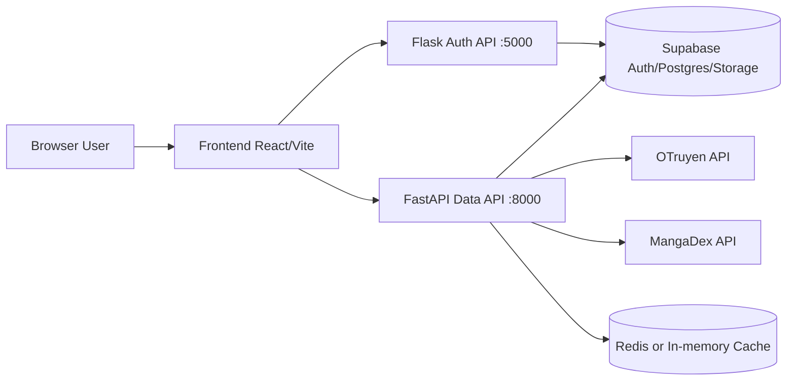
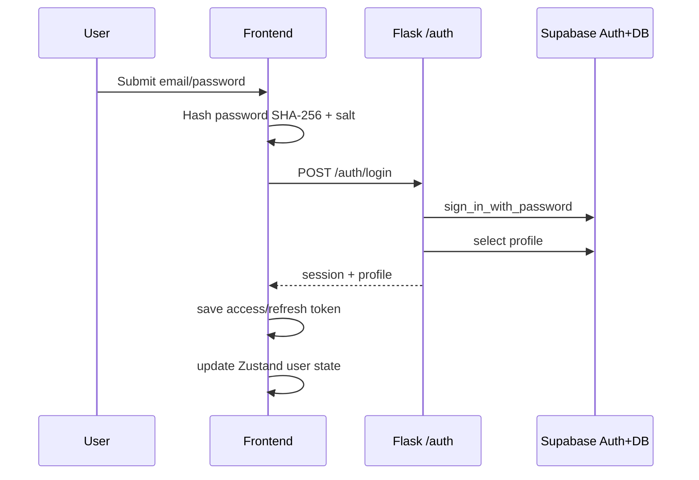

# README Data Flow Toan Bo Du An Manga-Bliss

## 0) Muc tieu tai lieu
Tai lieu nay mo ta luong du lieu dau vao/dau ra cua toan bo du an tu Frontend -> Backend -> DB/Storage -> External APIs -> quay lai UI.

Pham vi:
- Frontend React + TypeScript + React Query + Zustand
- Flask auth gateway
- FastAPI data service
- Supabase Auth + Postgres + Storage
- OTruyen API + MangaDex API
- Cache, background jobs, image proxy, moderation/admin analytics

Doc theo thu tu de hoc nhanh:
1. Kien truc tong quan
2. Luong khoi dong he thong
3. Luong front-end (route/store/hook)
4. Luong backend (Flask/FastAPI)
5. Luong DB va schema
6. Luong theo tinh nang (login, read, comment, upload, admin)

---

## 1) Kien truc tong quan

### 1.1 Thanh phan chinh
- Frontend SPA: `src/` (chay Vite port 8080)
- Flask Auth API: `backend/flask_app/` (port 5000)
- FastAPI Data API: `backend/fastapi_app/` (port 8000)
- Supabase:
  - Auth (`auth.users`)
  - Postgres (cac bang user-generated data)
  - Storage (bucket `manga-pages`, `comment-images`)
- External sources:
  - OTruyen API (list/detail/chapter)
  - MangaDex API (catalog/detail/chapter pages)
- Optional background worker: Celery + Redis (`backend/workers/`)

### 1.2 Topology

### 1.3 Port va endpoint root
- Frontend: `http://localhost:8080`
- FastAPI docs: `http://localhost:8000/docs`
- Flask auth root: `http://localhost:5000/auth/*`
- Health checks:
  - FastAPI: `GET /health`
  - Flask: `GET /health`

---

## 2) Luong khoi dong he thong

### 2.1 Entry point process
File: `backend/run.py`
- Spawn 2 process:
  - `run_flask()` -> Flask app (auth)
  - `run_fastapi()` -> Uvicorn FastAPI (data)
- Neu Ctrl+C: terminate 2 process

### 2.2 Config
File: `backend/config.py`
- Load `.env`
- Bien quan trong:
  - `SUPABASE_URL`, `SUPABASE_KEY`, `SUPABASE_SERVICE_KEY`
  - `FLASK_PORT`, `FASTAPI_PORT`, `FRONTEND_URL`
  - `REDIS_URL`
  - `MANGADEX_*` (transport/retry/timeout)

### 2.3 FastAPI lifespan
File: `backend/fastapi_app/main.py`
- Startup:
  - Core warmup cache OTruyen lists/categories
  - Start background `chapter_check_loop()`
  - Start cache refresh loop 5 phut
  - Deferred extended warmup
  - Schedule MangaDex warmup catalog/covers
- Shutdown:
  - Cancel background tasks

### 2.4 Cache runtime
File: `backend/fastapi_app/services/cache_service.py`
- Neu Redis available -> dung Redis
- Neu khong co Redis -> in-memory cache + persist ra `backend/.runtime_cache.json`
- Co TTL va stale strategy

---

## 3) Frontend data flow

### 3.1 App bootstrap
Files:
- `src/main.tsx`
- `src/App.tsx`

Flow:
1. Render `<App />`
2. Tao `QueryClient` (React Query)
3. Setup Router + lazy route pages
4. Chay `AuthLoader` de:
   - load user profile neu co token
   - load settings
   - dong bo notifications 30s
   - ping ban status 60s

### 3.2 Route-level guard
Files:
- `src/components/ProtectedRoute.tsx`
- `src/components/GuestRoute.tsx`

Rule:
- `ProtectedRoute`:
  - chua login -> redirect `/login`
  - banned -> hien `BannedPage`
  - role khong du -> hien `ForbiddenPage`
- `GuestRoute`:
  - da login -> redirect `/`

Role hierarchy frontend:
- `admin > moderator > uploader > reader`

### 3.3 Zustand stores

#### 3.3.1 User store
File: `src/store/userStore.ts`
- State:
  - `user`, `isLoggedIn`, `notifications`, `unreadCount`
- Auth actions:
  - `login`, `register`, `logout`, `loadUser`
- Notification actions:
  - `fetchNotifications`, `markNotificationRead`, `markAllNotificationsRead`
- Profile actions:
  - `updateProfile`, `uploadAvatar`

#### 3.3.2 Settings store
File: `src/store/settingsStore.ts`
- Load settings tu backend (`/api/users/settings`)
- Dong bo qua `readerStore`
- Debounced sync 1.5s khi user doi setting

#### 3.3.3 Reader store
File: `src/store/readerStore.ts`
- Persist local (`reader-settings`)
- Quan ly mode, direction, fit, toolbar, progress
- Save/get reading position theo manga

### 3.4 React Query hooks layer
File: `src/hooks/useApi.ts`

Hook -> API domain:
- Manga:
  - `useHome`, `useHomepage`, `useHomepageCombined`
  - `useMangaList`, `useMangaDetail`, `useChapter`
  - `useSearch`, `useCategories`, `useCategoryManga`, `useTrending`
- User data:
  - `useBookmarks`, `useToggleBookmark`
  - `useFollows`, `useToggleFollow`
  - `useHistory`, `useSaveHistory`
  - `useComments`, `useCreateComment`
  - `useNotifications`
  - `useUserStats`
  - `useRateManga`

### 3.5 API client layer
File: `src/lib/api.ts`

Co 2 base URL:
- `API_BASE` -> FastAPI (`VITE_API_URL`, default `:8000`)
- `AUTH_BASE` -> Flask (`VITE_AUTH_URL`, default `:5000`)

Co che auth/token:
- Access token + refresh token luu localStorage
- Tu dong refresh token neu access token sap het han
- Neu 401 -> thu refresh -> retry request
- Neu 403 va detect banned -> set `BAN_LOCK` + fire event force logout/banned
- Neu 451 -> throw `MANGA_HIDDEN::reason`

Luu y password:
- Frontend hash password SHA-256 co salt (`_SALT`) truoc khi gui den auth API

### 3.6 Adapter layer
File: `src/lib/adapters.ts`

Nhiem vu:
- Chuyen payload OTruyen/MangaDex ve shape type frontend
- Chuyen thumb URL ve proxy URL neu can
- Chuyen chapter image URL qua backend image proxy `/api/images/img?url=...`
- Chuan hoa pagination/status/fields

---

## 4) Backend auth flow (Flask)

### 4.1 Auth routes
File: `backend/flask_app/auth/routes.py`
Prefix: `/auth`

Endpoints:
- `POST /register`
- `POST /login`
- `POST /logout`
- `POST /forgot-password`
- `POST /verify-otp`
- `POST /reset-password`
- `GET /me`
- `GET /ping`
- `POST /refresh`
- `POST /google`
- `POST /discord`
- `POST /oauth/callback`
- `POST /oauth/code`

### 4.2 Data in/out trong auth flow

#### Register
Input:
- email, password(hash), username, displayName

Backend:
- Validate password strength (hoac chap nhan hash 64 hex)
- Check username ton tai trong `profiles`
- Call Supabase Auth `sign_up`

Output:
- message + user basic info

#### Login
Input:
- email, password(hash)

Backend:
- Supabase `sign_in_with_password`
- Fetch profile tu table `profiles`

Output:
- session tokens + user + profile

#### Me
Input:
- Bearer token

Backend:
- middleware verify token
- query `profiles` + `user_settings`

Output:
- profile + settings

### 4.3 Flask middleware
File: `backend/flask_app/middleware.py`
- `require_auth`:
  - verify token voi Supabase
  - cache auth/profile TTL ngan
  - attach role vao flask `g`
- `require_role(*roles)`:
  - check role hierarchy

---

## 5) Backend data flow (FastAPI)

### 5.1 FastAPI dependencies
File: `backend/fastapi_app/dependencies.py`
- `get_supabase()` tra ve client service role
- `get_current_user()` verify bearer token + role + banned status
- `require_role(...)` cho RBAC

Role hierarchy backend:
- `reader:0`, `uploader:1`, `moderator:2`, `admin:3`

### 5.2 Router mount map
File: `backend/fastapi_app/main.py`

- `/api/manga` -> `routers/manga.py`
- `/api/users` -> `routers/users.py`
- `/api/bookmarks` -> `routers/bookmarks.py`
- `/api/history` -> `routers/history.py`
- `/api/comments` -> `routers/comments.py`
- `/api/notifications` -> `routers/notifications.py`
- `/api/reports` -> `routers/reports.py`
- `/api/uploads` -> `routers/uploads.py`
- `/api/groups` -> `routers/groups.py`
- `/api/admin` -> `routers/admin.py`
- `/api/ratings` -> `routers/ratings.py`
- `/api/images` -> `routers/images.py`

### 5.3 Endpoint inventory (FastAPI)

#### Manga router (`/api/manga`)
- `GET /home`
- `GET /homepage`
- `GET /list/{list_type}`
- `GET /list-combined/{list_type}`
- `GET /categories`
- `GET /category/{slug}`
- `GET /detail/{slug}`
- `POST /{slug}/view`
- `GET /search`
- `GET /mangadex/vi-catalog`
- `GET /mangadex/chapter-pages/{chapter_id}`
- `GET /mangadex/detail/{manga_id}`
- `GET /chapter/{chapter_id}`
- `GET /random`
- `GET /trending`
- `GET /image-url`

#### Users router (`/api/users`)
- `GET /search`
- `GET /profile`
- `GET /profile/{user_id}`
- `PUT /profile`
- `POST /profile/avatar`
- `GET /settings`
- `PUT /settings`
- `GET /stats`

#### Bookmarks/Follows router (`/api/bookmarks`)
- `GET /`
- `POST /`
- `DELETE /{manga_slug}`
- `GET /check/{manga_slug}`
- `GET /follows`
- `POST /follows`
- `DELETE /follows/{manga_slug}`
- `GET /follows/check/{manga_slug}`

#### History router (`/api/history`)
- `GET /`
- `POST /`
- `DELETE /{manga_slug}`
- `DELETE /`

#### Comments router (`/api/comments`)
- `GET /me`
- `GET /manga/{manga_slug}`
- `POST /upload-image`
- `POST /`
- `PUT /{comment_id}`
- `DELETE /{comment_id}`
- `POST /{comment_id}/like`

#### Notifications router (`/api/notifications`)
- `GET /`
- `PUT /{notification_id}/read`
- `PUT /read-all`
- `DELETE /{notification_id}`
- `DELETE /`

#### Reports router (`/api/reports`)
- `POST /`
- `GET /`

#### Ratings router (`/api/ratings`)
- `GET /manga/{manga_slug}`
- `GET /manga/{manga_slug}/me`
- `POST /`
- `DELETE /manga/{manga_slug}`

#### Groups router (`/api/groups`)
- `GET /`
- `GET /{group_id}`
- `POST /`
- `PUT /{group_id}`
- `DELETE /{group_id}`
- `POST /{group_id}/members`
- `DELETE /{group_id}/members/{target_user_id}`

#### Uploads router (`/api/uploads`)
- `POST /images`
- `GET /`
- `GET /manga`
- `POST /manga`
- `GET /manga/{upload_id}`
- `PUT /manga/{upload_id}`
- `DELETE /manga/{upload_id}`
- `GET /{upload_id}`
- `POST /`
- `PUT /{upload_id}`
- `DELETE /{upload_id}`

#### Images router (`/api/images`)
- `GET /img`
- `GET /preload`

#### Admin router (`/api/admin`)
- `GET /stats`
- `GET /analytics`
- `GET /users`
- `GET /manga-list`
- `POST /manga/{slug}/hide`
- `POST /manga/{slug}/show`
- `PUT /manga/{slug}/settings`
- `POST /ban`
- `POST /unban/{user_id}`
- `POST /change-role`
- `GET /reports`
- `PUT /reports/{report_id}`
- `GET /comments/{comment_id}`
- `DELETE /comments/{comment_id}`
- `GET /audit-log`
- `GET /users/{user_id}/comments`
- `GET /users/{user_id}/history`
- `GET /uploads`
- `PUT /uploads/{upload_id}`
- `GET /manga-uploads`
- `PUT /manga-uploads/{upload_id}`
- `POST /notify`
- `PUT /users/{user_id}/vip`
- `GET /comments`
- `GET /export/users`

---

## 6) Service layer data flow

### 6.1 OTruyen service
File: `backend/fastapi_app/services/otruyen_service.py`

Data source strategy:
- Failover endpoints:
  - `https://otruyenapi.com/v1/api`
  - `https://sv1.otruyencdn.com/v1/api`
- HTTP engine: `curl_cffi` + browser impersonation

Caching strategy:
- Fresh cache key
- Neu miss: remote fetch
- Neu stale ton tai: tra stale ngay + refresh background
- TTL theo API type:
  - home/list/search/detail/chapter/categories

Special:
- Random pool memory (`refresh_random_pool`, `get_random_item`)

### 6.2 MangaDex service
File: `backend/fastapi_app/services/mangadex_service.py`

Transport strategy:
- `MANGADEX_TRANSPORT=auto|curl_cffi|httpx`
- Retry + backoff + timeout
- Khi network loi: fallback transport

Core outputs:
- VI catalog (`get_vi_catalog`)
- Search (`search_manga`)
- Detail (`get_manga_detail`)
- Chapter pages (`get_chapter_pages`)

Cache strategy:
- catalog/detail/chapter pages/total count
- stale fallback
- khong cache payload rong neu co the gay "lock" catalog rong

### 6.3 Chapter checker background
File: `backend/fastapi_app/services/chapter_checker.py`

Flow:
1. Moi 10 phut quet manga trong `follows`
2. Goi OTruyen detail lay chapter moi nhat
3. So sanh `last_chapter:{slug}` trong cache
4. Neu co chapter moi -> insert batch vao `notifications`

### 6.4 Image proxy
File: `backend/fastapi_app/routers/images.py`

Flow:
1. Frontend request `/api/images/img?url=...`
2. Backend check disk cache `backend/.image_cache`
3. HIT -> return file + ETag/304
4. MISS -> fetch upstream (curl_cffi/httpx), save disk, return

Muc tieu:
- giam latency khi doc lai chapter
- giam loi hotlink/CORS
- co fallback cho MangaDex cover variants

---

## 7) Database architecture

### 7.1 Tong quan schema
Nguon SQL:
- `backend/database/schema.sql`
- `backend/database/migration_v6_consolidated.sql`
- `backend/database/migration_v7_comment_images.sql`
- `backend/database/migration_v8_manga_overrides.sql`
- `backend/database/rls_policies.sql`
- `backend/database/storage_setup.sql`

### 7.2 Nhom bang theo domain

#### Identity va profile
1. `profiles`
- PK: `id` -> FK `auth.users(id)`
- Role, VIP, ban state, denormalized stats

2. `user_settings`
- PK/FK: `user_id -> profiles.id`
- Reader/notification/privacy settings

Trigger lien quan:
- `handle_new_user()` + trigger `on_auth_user_created`
- Tu dong tao `profiles` + `user_settings` sau khi signup Supabase

#### User bookshelf va reading
3. `bookmarks` (PK composite `user_id,manga_slug`)
4. `follows` (PK composite `user_id,manga_slug`)
5. `reading_history`
- PK `id`
- unique `(user_id,manga_slug,chapter_id)` (schema)
- app logic van de-duplicate thanh 1 row/manga trong API layer

#### Social
6. `comments`
- Co `parent_id` de nested reply
- Soft delete (`is_deleted`)
- `image_url` (them o migration v7)

7. `comment_likes`
- PK composite `(user_id,comment_id)`
- Trigger `update_comment_likes()` cap nhat counter `comments.likes`

8. `notifications`
- Type: `new_chapter|reply|system|follow_update`

9. `ratings`
- PK composite `(user_id,manga_slug)`
- score 1..5

10. `reports`
- report_type/status + admin note

#### Upload va group
11. `scanlation_groups`
12. `group_members`
13. `chapter_uploads`
14. `manga_uploads`
15. `audit_log`
16. `site_settings`

#### Analytics va metadata
17. `manga_views`
18. `manga_view_events`
19. `chapter_first_seen`
20. `manga_overrides` (migration v8)
- hide/show/featured/admin_notes cho moi slug manga

### 7.3 Functions / RPC

1. `increment_manga_view(p_manga_slug)`
- Upsert/increment `manga_views`

2. `get_manga_rating_aggregate(p_slug)`
- Tra average/count rating

3. `get_admin_stats()`
- Tra JSON tong hop metrics admin

4. `update_updated_at()`
- Trigger helper cap nhat `updated_at`

5. `update_comment_likes()`
- Trigger helper cap nhat `comments.likes`

### 7.4 Trigger map
- `on_auth_user_created` (auth.users -> profiles/settings)
- `tr_profiles_updated`
- `tr_comments_updated`
- `tr_settings_updated`
- `tr_ratings_updated`
- `tr_comment_likes_changed`
- `tr_uploads_updated`
- `tr_manga_uploads_updated`
- `tr_manga_overrides_updated`

### 7.5 Index map (nhom quan trong)
- Bookmarks/Follows theo `user_id`, `manga_slug`
- Reading history theo `user_id`, `read_at DESC`
- Comments theo `manga_slug`, `chapter_id`, `parent_id`, `user_id`
- Notifications theo `(user_id,is_read)`
- Reports theo `status`, `reporter_id`
- Uploads theo `uploader_id/status/group`
- Manga uploads theo `uploader_id/status/group/slug`
- View events theo `(manga_slug,created_at DESC)`
- Chapter first seen theo `(manga_slug,first_seen_at DESC)`
- Manga overrides theo `is_hidden`, `is_featured`

### 7.6 RLS policy tong quan
File: `backend/database/rls_policies.sql`

Pattern chung:
- User data: chi owner duoc read/write
- Public-readable data: comments non-deleted, ratings, manga_views, chapter_first_seen
- Admin-only read: `audit_log`
- Upload tables: owner hoac published
- `manga_overrides`: co policy read public, write qua service role backend

Luu y quan trong:
- FastAPI/Flask dang dung service key cho nhieu operation -> backend bypass RLS tai DB level
- Frontend direct DB access khong duoc su dung trong code nay, nen RLS van la defense layer can co

---

## 8) Supabase Storage data flow

### 8.1 Buckets
1. `manga-pages`
- Chapter page uploads
- Manga cover uploads
- Avatar uploads (`avatars/{user_id}/...`)

2. `comment-images`
- Comment image uploads

### 8.2 Upload paths (thuc te trong code)
- Chapter pages: `{manga_slug}/{chapter_number}/{user_id}/{page}.ext`
- Manga cover: `manga-covers/{slug}/{uuid}.ext`
- Avatar: `avatars/{user_id}/{uuid}.ext`
- Comment image: `{manga_slug}/{chapter_or_general}/{user_id}/{uuid}.ext`

### 8.3 Storage policies
- Public read cho manga pages va comment images
- Authenticated upload theo role/chinh sach
- Delete policy theo owner hoac moderator/admin

---

## 9) End-to-end luong theo tinh nang

## 9.1 Login flow

Data in:
- email + hashed password

Data out:
- session tokens + profile

### 9.2 Home/Browse flow
1. Page load -> hook `useHomepageCombined`
2. Frontend call:
   - `GET /api/manga/homepage`
   - `GET /api/manga/list-combined/truyen-moi`
3. FastAPI manga router:
   - OTruyen list
   - MangaDex VI catalog
   - hidden filter (`manga_overrides`)
   - attach ratings (local DB)
4. Response -> adapter -> UI cards

### 9.3 Manga detail + chapter list flow
1. FE route `/manga/:id`
2. Hook `useMangaDetail`
3. Neu slug MangaDex -> `GET /api/manga/mangadex/detail/{id}`
4. Neu OTruyen -> `GET /api/manga/detail/{slug}`
5. Backend enrich local views + chapter first seen
6. FE adapter convert chapter list for reader

### 9.4 Reader page flow
1. FE route `/chapter/:id`
2. Hook `useChapter`
3. MangaDex:
   - `GET /api/manga/mangadex/chapter-pages/{chapterId}`
   - pages proxied qua `/api/images/img?url=...`
4. OTruyen:
   - `GET /api/manga/chapter/{chapter_id}`
   - adapter convert to proxied image URLs
5. Reader render pages + track position local store

### 9.5 View counter flow
1. FE open chapter -> call `POST /api/manga/{slug}/view`
2. Backend canonicalize slug (ho tro UUID va `mdx-uuid`)
3. Try RPC `increment_manga_view`
4. Neu RPC fail -> manual upsert `manga_views`
5. Insert event vao `manga_view_events`

### 9.6 Bookmark/Follow/History flow
- Bookmarks/Follows:
  - FE optimistic update React Query
  - Backend CRUD bang `bookmarks`/`follows`
- History:
  - FE call `POST /api/history/`
  - Backend upsert by `(user,manga)` logic, preserve non-empty title/thumb
  - Update `profiles.chapters_read`

### 9.7 Comment + image flow
1. User upload image -> `POST /api/comments/upload-image`
2. Backend validate mime/size -> upload `comment-images`
3. User create comment -> `POST /api/comments/`
4. Neu la reply -> backend tao notification cho parent owner
5. Like/unlike -> `POST /api/comments/{id}/like`
6. Trigger DB update total likes

### 9.8 Upload + moderation flow
1. Uploader tao manga/chapter upload (`/api/uploads/...`)
2. Data + image vao DB/Storage, status `draft|pending`
3. Moderator/Admin review qua `/api/admin/uploads` hoac `/api/admin/manga-uploads`
4. Approve -> status `published`
5. Reject -> status `rejected` + reason
6. Audit actions ghi vao `audit_log`

### 9.9 Notification flow
Nguon tao notification:
- Reply comment
- Background chapter checker (new chapter cho followers)
- Admin broadcast `/api/admin/notify`
- VIP update

Consume:
- FE poll `/api/notifications` moi 30s
- mark read / mark all read / delete

### 9.10 Admin analytics flow
1. FE call `/api/admin/stats` + `/api/admin/analytics`
2. Backend query nhanh DB + cache
3. Top manga enrich title tu:
   - reading_history
   - manga_uploads
   - MangaDex detail (UUID va `mdx-uuid`)
   - OTruyen detail fallback
4. Views merge tu `manga_views` + `manga_view_events`

---

## 10) Error handling va fallback strategy

### 10.1 Frontend API layer
- Timeout -> throw user-friendly message
- 401 -> refresh token -> retry 1 lan
- 403 banned -> dat ban lock + force redirect banned
- 451 hidden manga -> throw `MANGA_HIDDEN::reason`

### 10.2 OTruyen service
- Multi endpoint failover
- Retry sync fetch
- Stale cache fallback neu remote fail

### 10.3 MangaDex service
- Multi transport fallback (`curl_cffi` <-> `httpx`)
- Retry/backoff
- stale cache fallback
- tranh cache payload rong cho catalog

### 10.4 Admin view consistency logic
- Canonical slug handling (`uuid` va `mdx-uuid`)
- Fallback views tu `manga_view_events` neu `manga_views` missing
- title fallback tu reading_history/manga_uploads/OTruyen/MangaDex

---

## 11) Mapping Frontend Page -> Hook -> API -> Router -> DB

| Page/Feature | Hook/API Frontend | Backend Endpoint | Main Tables |
|---|---|---|---|
| Home | `useHomepageCombined`, `mangaApi.getHomepage/getCombinedList` | `/api/manga/homepage`, `/api/manga/list-combined/*` | `ratings`, `manga_overrides` |
| Browse/Search | `useMangaList`, `useSearch` | `/api/manga/list/*`, `/api/manga/search` | `ratings`, `manga_overrides` |
| Manga Detail | `useMangaDetail` | `/api/manga/detail/{slug}` or `/api/manga/mangadex/detail/{id}` | `manga_views`, `chapter_first_seen`, `chapter_uploads`, `manga_overrides` |
| Reader | `useChapter` | `/api/manga/chapter/{id}` or `/api/manga/mangadex/chapter-pages/{id}` | (read external), local `manga_views` via view endpoint |
| View count | `mangaApi.addView` | `/api/manga/{slug}/view` | `manga_views`, `manga_view_events` |
| Bookmarks | `bookmarkApi.*` | `/api/bookmarks/*` | `bookmarks` |
| Follows | `followApi.*` | `/api/bookmarks/follows*` | `follows` |
| History | `historyApi.*` | `/api/history/*` | `reading_history`, `profiles` |
| Comments | `commentApi.*` | `/api/comments/*` | `comments`, `comment_likes`, `notifications` |
| Notifications | `notificationApi.*` | `/api/notifications/*` | `notifications` |
| Ratings | `ratingApi.*` | `/api/ratings/*` | `ratings` |
| Upload | `uploadApi.*` | `/api/uploads/*` | `chapter_uploads`, `manga_uploads`, `group_members`, `site_settings` |
| Groups | `groupApi.*` | `/api/groups/*` | `scanlation_groups`, `group_members` |
| Admin panel | `adminApi.*` | `/api/admin/*` | `profiles`, `reports`, `audit_log`, `manga_views`, `manga_view_events`, `manga_overrides`, upload tables |
| Auth | `authApi.*` | `/auth/*` (Flask) | Supabase Auth + `profiles`, `user_settings` |

---

## 12) Mapping DB table -> ai doc/ghi

| Table | Read by | Write by |
|---|---|---|
| `profiles` | Flask auth me/login, FastAPI users/admin | Supabase trigger `handle_new_user`, admin actions, profile update |
| `user_settings` | Flask auth me, FastAPI users/settings | trigger create + users/settings update |
| `bookmarks` | bookmarks router | bookmarks router |
| `follows` | follows router, chapter checker | follows router |
| `reading_history` | history router, admin analytics, user stats | history router |
| `comments` | comments router, admin moderation | comments router/admin |
| `comment_likes` | comments router | comments router |
| `notifications` | notifications router | comments reply, chapter checker, admin broadcast, vip update |
| `ratings` | ratings router, manga router attach ratings | ratings router |
| `reports` | reports router, admin router | reports router + admin update |
| `scanlation_groups` | groups router | groups router |
| `group_members` | groups/uploads router | groups router |
| `chapter_uploads` | uploads/admin/manga detail local merge | uploads/admin |
| `manga_uploads` | uploads/admin/analytics/title fallback | uploads/admin |
| `audit_log` | admin router | admin router helper `_log_action` |
| `manga_views` | manga detail/trending/admin analytics | manga view endpoint + admin recovery upsert |
| `manga_view_events` | admin analytics, admin manga list | manga view endpoint |
| `chapter_first_seen` | manga detail | manga detail backfill |
| `site_settings` | uploads max file size | SQL/admin side updates |
| `manga_overrides` | manga router hidden filter, admin list | admin hide/show/settings |

---

## 13) Security va quyen

### 13.1 App-level RBAC
- Frontend guard + backend dependency/decorator check role
- Role hierarchy consistent giua Flask/FastAPI

### 13.2 Token va session
- Supabase JWT verify server-side
- Frontend refresh token auto
- Ban lock local de ngan user banned tiep tuc truy cap

### 13.3 DB-level RLS
- Owner-only cho data private
- Public read co kiem soat cho data can hien thi cong khai
- Service role backend co quyen ghi cac luong moderation/analytics

---

## 14) Performance notes

1. React Query cache + staleTime giam so request
2. OTruyen/MangaDex service cache + stale fallback giu app responsive khi upstream loi
3. Disk image cache + ETag giam bandwidth va load page reader nhanh
4. FastAPI startup warmup giam cold-start latency
5. Admin stats/analytics co in-process TTL cache

---

## 15) Debugging roadmap theo trieu chung

### 15.1 Login loi hoac logout bat thuong
Kiem tra:
- `src/lib/api.ts` (refresh flow, 401/403 handling)
- `backend/flask_app/auth/routes.py`
- `backend/flask_app/middleware.py`

### 15.2 Manga list/detail cham hoac trong
Kiem tra:
- `backend/fastapi_app/services/otruyen_service.py`
- `backend/fastapi_app/services/mangadex_service.py`
- cache runtime (`Redis` hoac `.runtime_cache.json`)

### 15.3 Reader image fail
Kiem tra:
- `backend/fastapi_app/routers/images.py`
- `src/lib/adapters.ts` (page URL mapping)
- mang/image host policy

### 15.4 View admin khong dung
Kiem tra:
- `backend/fastapi_app/routers/manga.py` (`add_view`)
- `backend/fastapi_app/routers/admin.py` (`/manga-list`, `/analytics`)
- tables `manga_views`, `manga_view_events`

### 15.5 Upload bi reject hoac khong thay
Kiem tra:
- `backend/fastapi_app/routers/uploads.py`
- `site_settings.max_upload_size_mb`
- Supabase Storage policy va bucket

---

## 16) Learning checklist (tu co ban -> nang cao)

1. Doc `src/lib/api.ts` de hieu contract FE <-> BE
2. Doc `src/hooks/useApi.ts` de hieu data orchestration tren frontend
3. Doc `backend/fastapi_app/main.py` + `dependencies.py` de hieu backbone backend
4. Doc tung router theo domain (`manga`, `users`, `comments`, `admin`)
5. Doc `schema.sql` + `migration_v6/v7/v8` + `rls_policies.sql`
6. Chay thuc te va theo doi payload trong network tab
7. Dung `/docs` de test endpoint doc lap

---

## 17) Appendix: Flask auth endpoint inventory

Prefix `/auth`:
- `POST /register`
- `POST /login`
- `POST /logout`
- `POST /forgot-password`
- `POST /verify-otp`
- `POST /reset-password`
- `GET /me`
- `GET /ping`
- `POST /refresh`
- `POST /google`
- `POST /discord`
- `POST /oauth/callback`
- `POST /oauth/code`

---

## 18) Appendix: File map quan trong de trace data flow

Frontend:
- `src/App.tsx`
- `src/lib/api.ts`
- `src/hooks/useApi.ts`
- `src/lib/adapters.ts`
- `src/store/userStore.ts`
- `src/store/settingsStore.ts`
- `src/store/readerStore.ts`

Backend:
- `backend/run.py`
- `backend/config.py`
- `backend/flask_app/auth/routes.py`
- `backend/flask_app/middleware.py`
- `backend/fastapi_app/main.py`
- `backend/fastapi_app/dependencies.py`
- `backend/fastapi_app/routers/*.py`
- `backend/fastapi_app/services/*.py`

Database/Storage:
- `backend/database/schema.sql`
- `backend/database/migration_v6_consolidated.sql`
- `backend/database/migration_v7_comment_images.sql`
- `backend/database/migration_v8_manga_overrides.sql`
- `backend/database/rls_policies.sql`
- `backend/database/storage_setup.sql`

---

Neu ban muon, buoc tiep theo co the tao them 1 file rieng chuyen ve:
- Sequence diagram cho tung API quan trong
- ERD chi tiet tung FK/index
- Hoac runbook migration DB theo thu tu an toan cho production.
